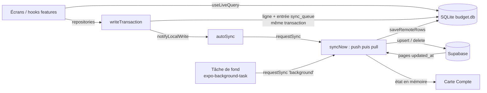

# Store local, synchronisation et asynchrone

Description de l'implémentation actuelle (lecture du code). Les **règles** restent dans
`docs/STORAGE.md` ; ce document explique **comment** elles sont appliquées et où trouver le code.

## 1. Vue d'ensemble

- **SQLite est la source de vérité de l'UI** : aucun écran ne lit Supabase. Le client Supabase
  (`src/lib/supabase.ts`) n'est utilisé que par l'auth et `src/sync/`.
- **Pas d'état optimiste** : l'UI se met à jour parce que SQLite change (requêtes réactives), pas
  parce qu'un store mémoire est modifié.
- **Stores sans React** : l'état de la synchro, du pull initial, des toasts et le signal
  « écriture locale » sont des modules à listeners (`subscribe…` / `get…`), lus en React via
  `useSyncExternalStore`. Ils sont ainsi utilisables depuis la tâche de fond et le moteur de synchro.

| Couche | Dossier | Rôle |
| --- | --- | --- |
| Connexion / schéma | `src/db/` | ouverture, migrations Drizzle, schéma, `LiveData` |
| Accès aux données | `src/repositories/` | requêtes de lecture, écritures via l'outil commun, file, réglages |
| Moteur de synchro | `src/sync/` | push, pull, verrou, relances, déclencheurs, pull initial, session |
| Glue React | `src/features/sync/`, `src/features/account/` | hooks d'état, tâche de fond, reconnexion, carte Compte |
| Erreurs | `src/lib/errors.ts`, `src/lib/toast.ts`, `src/lib/captureError.ts` | toast 3 s, journal, Sentry |

## 2. Base locale

### Ouverture et migrations

- `src/db/client.ts` : connexion unique `openDatabaseSync('budget.db', { enableChangeListener: true })`
  (le change listener alimente `useLiveQuery`). `prepareDatabase()` ouvre puis migre ; une
  préparation en cours est **partagée** (démarrage, double effet en dev, « Réessayer », tâche de
  fond) et un échec réinitialise la connexion.
- `src/db/DatabaseProvider.tsx` : appelle `prepareDatabase(runMigrations)` au montage. Rien n'est
  rendu pendant la préparation (le splash reste affiché, `onSettled` le masque) ; en cas d'échec,
  `DatabaseErrorScreen` avec « Réessayer ». `useDatabase()` expose l'instance Drizzle.
- Migrations Drizzle dans `src/db/migrations/` (générées par `npm run db:generate`), appliquées
  aussi par la tâche de fond, qui peut tourner avant toute ouverture de l'UI.

### Schéma (`src/db/schema.ts`)

Tables synchronisées (`SYNCED_TABLES`) : `categories`, `transactions`, `recurring_payments`,
`recurring_occurrences`, `debt_people`, `debts`, `debt_repayments`.

Conventions communes : `id` UUID généré sur le client, `user_id` sur chaque ligne, `created_at` /
`updated_at` ISO gérés par le client, `deleted_at` pour la suppression logique, montants entiers,
contraintes `CHECK`. **Pas de clés étrangères SQL** : le pull et l'import peuvent insérer dans
n'importe quel ordre, la cohérence est vérifiée par les repositories. Toute contrainte unique
commence par `user_id`.

Exceptions :
- `recurring_occurrences` n'a pas de `deleted_at` (pas supprimée, ignorée si son paiement l'est) ;
- `debt_people` est à **suppression définitive** (`HARD_DELETABLE_TABLES`), sans `deleted_at`.

Tables locales uniquement :
- `sync_queue` : file d'envoi (voir §4) ;
- `settings` : clé/valeur par compte — `last_eur_rate`, `last_pulled_at`, `last_synced_at`.

Hors SQLite : le compte local (`id`, `email`, `name`) est dans SecureStore
(`src/features/auth/localAccount.ts`), la session Supabase dans un stockage chiffré
(`src/lib/secureSessionStorage.ts`).

## 3. Lectures

- Chaque repository expose des **constructeurs de requêtes** (ex. `monthTransactionsQuery`) filtrés
  par `user_id` et `deleted_at IS NULL`.
- Les hooks de `features/*/use….ts` les passent à `useLiveQuery` (drizzle-orm/expo-sqlite) et
  renvoient un `LiveData<T>` : `loading` | `ready` | `error` (`src/db/liveData.ts`).
  `useReportReadError` affiche un toast en cas d'échec de lecture.
- Les écrans affichent des skeletons pendant `loading` et un bloc d'erreur (`ReadErrorCard`)
  pendant `error`.

## 4. Écritures et file `sync_queue`

### Outil d'écriture commun (`src/repositories/write.ts`)

Toute écriture d'une table synchronisée passe par `writeTransaction(db, userId, fn)` ou ses
raccourcis `insertRow` / `updateRow` / `softDeleteRow`. Le `Writer` fourni au callback propose
`insert`, `update`, `softDelete`, `hardDelete`.

- La ligne **et** son entrée `sync_queue` sont écrites dans **la même transaction SQLite** :
  échec ⇒ rien n'est écrit, l'erreur remonte à l'appelant (affichée dans le formulaire).
- L'outil renseigne lui-même `id`, `user_id`, `created_at`, `updated_at`, `deleted_at`.
- `nextTimestamp(previous)` garantit un `updated_at` strictement postérieur à la version
  précédente, même si l'horloge du téléphone recule.
- Le payload de la file est la **ligne relue après écriture** (valeurs par défaut et `NULL` inclus),
  `op: 'upsert'`. Pour `hardDelete`, la ligne est effacée et l'entrée est `op: 'delete'` avec un
  payload réduit à `{ id, userId }`.
- Le callback **doit être synchrone** (le pilote expo-sqlite exécute la transaction de façon
  synchrone) : une Promise renvoyée ou une écriture après fermeture lève une erreur.
- `RowNotFoundError` si la ligne n'existe pas, est supprimée ou appartient à un autre compte.
- Les opérations composées (« J'ai payé » = dépense + occurrence, import JSON) utilisent un seul
  `writeTransaction` : elles sont atomiques.
- Après validation, si des entrées ont été ajoutées, `notifyLocalWrite(userId)`
  (`src/repositories/localWrites.ts`) prévient le moteur de synchro. Une erreur d'abonné ne remonte
  jamais à l'écriture.

### File (`src/repositories/syncQueue.ts`)

Colonnes : `table_name`, `row_id`, `op`, `payload` (JSON), `attempts`, `last_error`, `rejected_at`,
`created_at`. Ordre de traitement : `rowid` (ordre d'insertion).

- `readQueueBatch` : plus anciennes entrées envoyables (hors mises de côté).
- `removeQueueEntries` : retrait **par id d'entrée** — une écriture faite pendant l'envoi reste.
- `markQueueFailure` : `attempts + 1`, `last_error` (erreur passagère).
- `rejectQueueEntries` / `requeueRejectedEntries` : mise de côté (`rejected_at`) et remise en file.
- `removeRejectedEntriesForRows` : une version plus récente envoyée rend les versions mises de côté
  de la même ligne obsolètes.
- Compteurs : `pendingSyncCount` (mises de côté comprises, c'est le « non synchronisé »),
  `sendableSyncCount`, `rejectedSyncCountQuery` ; versions requêtes à observer pour la carte Compte.

## 5. Push (`src/sync/push.ts`)

`pushToSupabase` vérifie la session (`requireSession`) puis `pushAll` :

1. lit la file par lots de **200** entrées (`PUSH_BATCH_SIZE`) ;
2. regroupe chaque lot **par table puis par ligne** : une ligne écrite plusieurs fois n'est envoyée
   qu'une fois, dans sa dernière opération (Postgres refuse deux modifications de la même ligne dans
   un upsert) ;
3. convertit le payload camelCase → snake_case (`toRemote`, `src/sync/columns.ts`, déduit du schéma
   Drizzle) ; un payload d'un autre compte ou avec une colonne inconnue est mis de côté sans envoi ;
4. par table : d'abord les **suppressions définitives** (`delete … where user_id and id in`), puis
   les **upserts** (`upsert(rows, { onConflict: 'id' })`) — les suppressions libèrent les valeurs
   uniques (personne recréée avec le même nom) ;
5. succès ⇒ entrées retirées de la file ; progression `done / total` remontée au store.

Classement des erreurs (`classifyErrorCode`) :

| Nature | Codes | Traitement |
| --- | --- | --- |
| Refus de la ligne (`rejected`) | `22xxx`, `23xxx`, `42501` | envoi groupé refusé ⇒ renvoi **ligne par ligne** pour isoler les fautives, mises de côté (`rejected_at`) ; les autres partent, la file n'est pas bloquée |
| Passagère (`transient`) | réseau (code vide), `PGRST…`, tout le reste | entrées non traitées du lot marquées (`attempts`, `last_error`), **arrêt** du push, l'erreur remonte (ordre préservé) |

Les refus d'un push sont regroupés en **un seul** événement Sentry (table, op, message technique,
sans valeur).

Côté serveur (`supabase/migrations/`) : RLS `user_id = auth.uid()` en select/insert/update, politique
`DELETE` propriétaire pour `debt_people`, et trigger `skip_stale_update` qui ignore silencieusement
un update dont `updated_at` n'est pas strictement plus récent — l'upsert est donc **relançable**
sans doublon ni régression.

## 6. Pull (`src/sync/pull.ts`)

`pullFromSupabase` vérifie la session puis `pullAll` :

- pour chaque table de `SYNCED_TABLES`, lit les lignes `user_id = moi` et
  `updated_at >= last_pulled_at`, triées par `(updated_at, id)`, par pages de **1000** ;
- pagination **par curseur** (`updated_at > x OR (updated_at = x AND id > y)`) : aucune ligne
  sautée ni répétée si des données changent pendant le pull ;
- chaque ligne est validée et convertie (`toLocal` : colonnes présentes, horodatages normalisés en
  ISO milliseconde) avant toute écriture ;
- le repère `last_pulled_at` est le plus grand `updated_at` **reçu du serveur** (jamais l'horloge
  du téléphone), enregistré seulement **après toutes les tables** : un pull interrompu reprend au
  même point (l'enregistrement est idempotent).

Enregistrement local (`saveRemoteRows`, `src/repositories/remoteRows.ts`) :

- ne passe **pas** par l'outil d'écriture : une ligne reçue n'entre jamais dans `sync_queue`
  (pas de boucle pull → push), et `notifyLocalWrite` n'est pas émis ;
- `INSERT … ON CONFLICT(id) DO UPDATE … WHERE` : une ligne existante n'est remplacée que si
  `excluded.updated_at > updated_at` **et** qu'aucune entrée de cette ligne n'attend dans la file
  (la version locale partira au push et gagnera côté serveur si elle est plus récente) ;
- une ligne dont la suppression définitive attend dans la file n'est pas réinsérée ;
- `id`, `user_id`, `created_at` ne sont jamais modifiés ; lignes d'un autre compte refusées ;
  lots de 100 lignes, dans une transaction.

**Résolution des conflits** : la modification la plus récente (`updated_at`) gagne, des deux côtés.
Limite assumée (un seul téléphone en v1) : une ligne écrite plus tard par un autre appareil avec un
`updated_at` antérieur au repère ne serait pas récupérée.

## 7. Orchestration (`src/sync/syncNow.ts`)

Une synchronisation = **push puis pull** (`pull: false` pour la déconnexion), puis
`last_synced_at`.

### Deux points d'entrée

- `syncNow(db, userId, options)` — appel **explicite** (bouton « Synchroniser », déconnexion,
  reconnexion, envoi après pull initial) : annule la relance programmée et remet le compteur de
  délais à zéro.
- `requestSync(db, userId, trigger)` — déclencheurs **automatiques** :
  `startup` | `network` | `foreground` | `write` | `background`.

Les deux **ne rejettent jamais** : le résultat est
`{ ok: true } | { ok: false, reason: 'offline' | 'session' | 'failed' }` et l'état est publié.

### Verrou

Une seule synchronisation à la fois par compte : `runLocked` renvoie la promesse en cours à tout
appel concurrent. Chaque requête Supabase est annulée après **30 s** sans réponse
(`src/lib/fetchWithTimeout.ts`, passé au client Supabase) pour qu'une connexion morte ne bloque
jamais le verrou ; l'échec devient passager avec le message « Le serveur ne répond pas. » et n'est
pas envoyé à Sentry.

### Règles des déclencheurs automatiques

| Situation | Comportement |
| --- | --- |
| Session refusée (`sessionRefused`) | rien jusqu'à la reconnexion |
| Hors ligne (`isOnline()` NetInfo ; état inconnu = en ligne) | rien : aucune requête, aucune erreur, état inchangé |
| Synchro en cours + `background` | attend la synchro en cours |
| Synchro en cours + `write` | **une** seconde synchro demandée à la fin (si la première a réussi) |
| `startup`, `network`, `background` | relance programmée annulée, synchro immédiate |
| `foreground`, `write` avec relance programmée | rien : la relance enverra toute la file |
| `foreground` < 60 s après la dernière synchro | rien (`FOREGROUND_MIN_INTERVAL_MS`) |

### Relances (côté client)

Après un échec passager, app ouverte : `scheduleRetry` programme une relance avec délais croissants
`10 s → 30 s → 1 min → 5 min → 15 min` (le dernier se répète), `nextRetryAt` est publié. Pas de
relance hors ligne (le retour du réseau s'en charge), ni si la session est refusée, ni en tâche de
fond. trigger.dev n'est pas utilisé ici : les données n'existent que sur le téléphone.

### État publié (`SyncRunState`, en mémoire)

`{ userId, running, progress (0→1), error, nextRetryAt, sessionRefused }`, lu via
`subscribeSyncRun` / `getSyncRunState`. Les lignes mises de côté déclenchent un toast
(« N éléments refusés par le serveur… », sauf en tâche de fond).

## 8. Déclencheurs (`src/sync/autoSync.ts`)

`startAutoSync(db, userId)`, monté par `src/app/(app)/_layout.tsx` pour le compte connecté :

- `startup` immédiat ;
- `network` : passage **avéré** hors ligne → en ligne (`NetInfo.addEventListener`) ;
- `foreground` : `background`/`inactive` → `active` (`AppState`) ;
- `write` : abonnement à `subscribeLocalWrites`, regroupé par un debounce de **2 s**.

Tant que le pull initial du compte n'est pas `ready`, ces déclencheurs ne synchronisent pas ; s'il
est en `error`, `network` et `foreground` relancent le pull initial (si en ligne).

Le layout appelle aussi `cancelScheduledSync(userId)` au démontage (déconnexion, changement de
compte) et `registerBackgroundSync()`.

## 9. Pull initial (`src/sync/initialPull.ts`)

Store `InitialPullStatus` : `loading` | `error` | `reauth` | `ready`.

- Lancé à chaque connexion Google (`LoginScreen` → `signInWithGoogle(onSignedIn)` →
  `startInitialPull`, juste avant que le compte soit considéré connecté) et au démarrage via
  `resumeInitialPull` si `last_pulled_at` est absent (sinon marqué `ready` directement).
- Un seul à la fois par compte (promesse partagée), ne rejette jamais.
- Succès exigé : pull complet **et** au moins une catégorie locale (créées côté Supabase à la
  création du compte, migration `create_default_categories`).
- Ensuite, si la file contient des éléments d'une session précédente du compte, `syncNow` en
  arrière-plan (toast si échec).
- `SessionError` ⇒ `reauth` ; autre erreur ⇒ `error` (Sentry).

`useInitialPull()` (`src/features/sync/useInitialPull.ts`) expose `status`, `ready`, `failed`,
`retry`. Avant l'évaluation, le statut est déduit de `last_pulled_at` pour éviter un flash. Les
écrans affichent des skeletons pendant `loading`, `InitialPullError` (« Réessayer » ou « Se
reconnecter avec Google ») si `failed`, et les actions dépendantes des données (saisie, export,
import, synchro) sont gardées par `ready` **dans le handler**.

## 10. Tâche de fond (`src/features/sync/backgroundSync.ts`)

- `TaskManager.defineTask` au chargement du bundle (`index.ts`, avant le routeur) : Android peut
  lancer l'app sans écran pour l'exécuter.
- Enregistrée (`expo-background-task`, intervalle minimum **15 min**, décidé par Android) à
  l'ouverture de l'app connectée ; retirée à la déconnexion manuelle. Enregistrements et retraits
  sont sérialisés.
- Chaque exécution, indépendante de React : `prepareDatabase` (migrations comprises), lecture du
  compte local, puis `requestSync(…, 'background')` si le compte a déjà été récupéré.
- Issues : `signedOut`, `notPulled`, `skipped` (hors ligne / session refusée), `synced`, `failed`.
  Ni relance programmée ni toast ; l'erreur reste visible sur la carte Compte.

## 11. Session et authentification

- **Connecté = compte local présent** (`AuthProvider`), indépendamment du token Supabase.
- `requireSession(userId)` (`src/sync/session.ts`) avant tout push/pull :
  - rafraîchissement impossible faute de réseau ⇒ erreur passagère (relancée) ;
  - session absente, illisible ou d'un autre compte ⇒ `SessionError` ⇒ état `sessionRefused`
    (« Reconnexion requise »), déclencheurs automatiques en pause.
- `AuthProvider` suit `onAuthStateChange` : `SIGNED_OUT` (refresh refusé) ⇒ `needsReauth` ; une
  session d'un autre compte est écartée. Hors ligne avec token expiré, la session émise à `null`
  mais encore stockée ne demande pas de reconnexion.
- `SupabaseAutoRefresh` ne rafraîchit le token qu'au premier plan.
- Reconnexion (`useReconnect`) : Google avec email attendu, puis contrôle du `user_id` ; ensuite
  `resumeAfterReconnect` relance le pull initial s'il n'a pas abouti, sinon `syncNow`.
- `ReauthNotifier` affiche un toast une fois par lancement quand la reconnexion est requise.
- **Déconnexion manuelle** (`AccountScreen` → `signOut`) : si des éléments attendent, `syncNow`
  push seul (loader dans la modale) ; s'il en reste, avertissement avec leur nombre. Aucune donnée
  locale ni entrée de file n'est supprimée : elles restent rattachées à leur `user_id` et partiront
  à la prochaine connexion de ce compte.
- **Changement de compte** : toutes les lectures, écritures, files et réglages sont filtrés par
  `user_id` ; les données d'un autre compte restent intactes et inactives.

## 12. État affiché (carte Compte)

`useSyncStatus()` (`src/features/account/useSyncStatus.ts`) combine le store de synchro, le pull
initial, `needsReauth`, et des requêtes réactives (`pendingSyncCount`, `rejectedSyncCount`,
`last_synced_at`) en un `SyncStatus` (`src/types/sync.ts`), par priorité :

1. compteur illisible ⇒ `error` ;
2. synchro en cours ⇒ `syncing` (progression) ;
3. reconnexion requise ⇒ `reauth` ;
4. dernière tentative échouée ⇒ `error` (message, `nextRetryAt`) ;
5. éléments mis de côté ⇒ `error` (« refusés par le serveur ») ;
6. file non vide ⇒ `pending` ;
7. sinon ⇒ `synced`.

« Synchroniser » / « Réessayer » remet d'abord les entrées mises de côté dans la file
(`requeueRejectedEntries`), puis appelle `syncNow`.

## 13. Erreurs et retours utilisateur

- `reportError({ scope, message, error, key })` : journal + toast 3 s, anti-doublon par clé ;
  `showToast` pour un message simple ; `captureError` pour Sentry (sans montant ni note).
- Erreurs de formulaire et d'import : affichées dans l'écran ou la modale, pas en toast.
- Les handlers d'actions asynchrones utilisent un garde (`useRef` `inFlight`, `ready`) en plus du
  `disabled`, avec spinner dans le bouton ; l'import attend une frame avant sa transaction
  synchrone pour laisser le spinner s'afficher.

## 14. Import / export JSON (`src/repositories/backup.ts`)

- Export : lignes non supprimées du compte, sans `user_id` ni `deleted_at`.
- Import : remplacement de toutes les données du compte en **un seul** `writeTransaction`
  (suppressions logiques, suppression définitive des personnes, catégories modifiées sur place,
  nouvelles lignes) : atomique, et chaque modification part dans `sync_queue` comme une saisie.

## 15. Tests

Tests unitaires sur SQLite réel (better-sqlite3, `src/test/testDatabase.ts`) avec dépendances
réseau injectées : `src/repositories/__tests__/` (outil d'écriture, file, enregistrement distant,
import) et `src/sync/__tests__/` (push, pull, conflits, colonnes, verrou et relances, déclencheurs,
pull initial, session), plus `src/features/sync/__tests__/backgroundSync.test.ts`.
